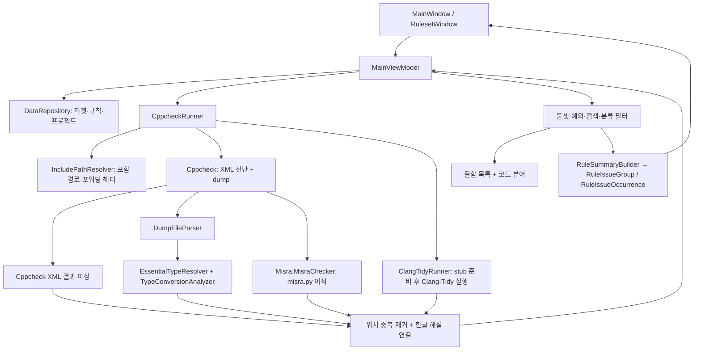
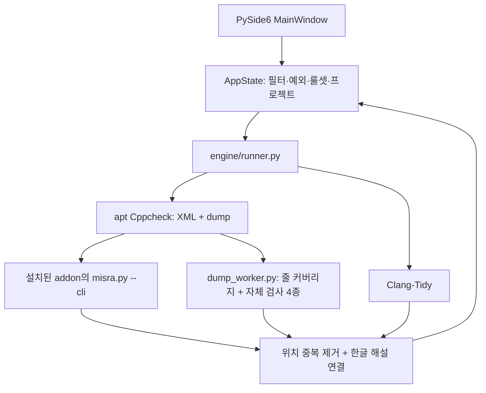

# 02. 시스템 아키텍처 및 분석 엔진

## 구성

.NET 10 WPF UI와 `MainViewModel`, 외부 도구 실행 서비스, C# 분석 모델을 사용합니다. 별도의 `AnalysisOrchestrator` 클래스는 없으며 `CppcheckRunner`가 분석을 통합합니다.

## 분석 흐름

### 1. 입력과 포함 경로 준비

`MainViewModel`이 설정·트리의 입력 스냅샷을 만들어 백그라운드에서 `CppcheckRunner.RunAnalysisAsync`를 실행합니다. 검사 대상 파일을 보고 위치 집합으로 유지하고 `.c`/`.cpp`를 우선 실행 입력으로 선택합니다. 소스가 없으면 대상 파일을 직접 입력합니다.

`IncludePathResolver`는 대상·참조 트리의 디렉터리와 파일을 수집하고, 포함 경로의 상위 디렉터리 추정 및 임시 포워딩 헤더로 경로 차이를 보완합니다. 참조 파일을 `-i`로 제외하지 않으며, 파싱된 진단 중 대상 파일에 속한 위치를 보고합니다.

### 2. Cppcheck 실행과 산출물 보호

공통 옵션은 `--enable=all --inconclusive --check-level=exhaustive -j<코어수> --xml --dump --std=<선택값>`입니다. 존재하는 플랫폼 XML을 `--platform=`으로 지정하고 프리셋·사용자 매크로와 `-I` 경로를 추가합니다. UI 옵션에 따라 `--force`를 추가합니다. 현재 코드에는 `--xml-version=2` 인자가 없습니다.

`DumpFileGuard`가 기존 `<소스>.dump`와 `<소스>.ctu-info`를 백업한 뒤 실행합니다. 새 dump는 소스 옆에 생성되므로 그 디렉터리에 쓰기 권한이 필요합니다. 종료·취소·오류 시 새 산출물을 정리하고 기존 파일을 복원합니다. 복원 실패 시 백업이 남을 수 있습니다.

첫 실행의 dump에 나타나지 않은 대상 `.h`/`.hpp`는 두 번째 실행에서 직접 분석합니다. 소스 문맥이 없는 직접 헤더 분석의 제한을 노트로 알립니다.

### 3. XML 및 dump 해석

- XML 진단에서 파일·줄·열·ID·메시지를 읽고 등록 규칙의 한글 해설을 연결합니다.
- 헤더 누락과 분석 범위 제한은 노트로 분리합니다. 유효한 결과 XML을 해석할 수 없으면 예외로 처리하여 0건으로 오인하지 않게 합니다.
- `DumpFileParser`는 플랫폼 폭, 토큰 링크·AST, 변수·스코프·함수, 지시문을 모델로 만듭니다.
- 전처리 후 `tokenlist`의 파일·줄을 분석 줄 집합으로 수집하고, `rawtokens`의 코드 줄 중 분석 집합에 없는 줄을 미검사로 분류합니다. 토큰 파일 경로는 `file`, raw token 파일 인덱스는 `fileIndex`를 사용합니다.
- 여러 설정·번역 단위의 분석 줄은 합집합으로 병합합니다. 토큰 기반 커버리지는 모든 규칙의 판정 성공이나 완전한 분기 커버리지의 증명이 아닙니다.
- 파일별 `.dump` 해석(`MisraChecker.CheckDump`, `DumpFileParser.Parse`, `TypeConversionAnalyzer.Analyze`)은 논리 코어 수만큼 병렬로 수행하고, 중복 제거·커버리지·노트 병합은 입력 파일 순서대로 직렬 반영합니다.

### 4. C# MISRA 검사기

`Services/Misra/`는 Cppcheck 2.22 `addons/cppcheckdata.py`·`misra.py`·`misra_9.py`를 C#으로 옮긴 것입니다. dump마다 원본 `misra.py --cli <dump>`와 같은 순서로 규칙 함수를 실행하고, 같은 규칙 ID(`misra-c2012-X.Y`, 설정 누락 안내 `misra-config`)와 같은 파일·줄·열을 보고합니다. 원본처럼 같은 위치·규칙은 한 번만 보고하고, 원본 Python이 예외로 중단되는 dump에서는 그 전까지의 위반만 보고합니다.

- 원본의 Python 동작(문자열 `in` 부분 문자열 검사, 음수 색인, `None` 서식, `is_errno_setting_function`의 쉼표 누락으로 합쳐진 함수 이름 등)도 결과가 같도록 그대로 옮겼습니다.
- 표준 라이브러리 식별자·키워드 표(`MisraTables.cs`)는 원본 모듈 상수에서 `MisraParity/gen_misra_tables.py`로 생성합니다.
- 파일 간(CTU) 규칙 2.3, 2.4, 2.5, 5.6~5.9, 8.5~8.7은 원본도 단일 dump 실행에서 요약만 남기므로 보고하지 않습니다.
- 9.1은 `CppcheckRunner`에서 `uninitvar`, `uninitdata`, `uninitStructMember`를 매핑합니다.

**차분 검증:** `MisraParity/compare_misra.py <dump 폴더>`는 같은 dump에 원본 `misra.py`와 C# 검사기를 실행해 위반 목록을 비교합니다. Cppcheck 2.22 공식 misra 테스트 파일(4가지 표준·플랫폼 조합), `test/cfg`·`samples` C 파일, 내장 샘플, 65개 파일의 실제 프로젝트로 만든 dump 177개에서 원본 위반 59,357건과 모두 일치했습니다. Cppcheck를 올리면 표를 다시 생성하고 이 비교를 다시 실행해야 합니다.

### 5. 자체 타입 변환 검사

`EssentialTypeResolver`는 가능한 식에 대해 필수 타입 범주·비트 폭을 계산하고, `TypeConversionAnalyzer`가 MISRA와 별도인 자체 ID `implicitNarrowing`, `implicitSignConversion`, `explicitNarrowingCast`, `pointerSizeMismatch`를 보고합니다. 대입·인자·반환의 변환은 정수 승격 후 타입만으로 판정하지 않으며, 정수 상수식의 표현 가능 범위 예외를 처리합니다. 캐스트 자체와 캐스트 결과에서 최종 대상까지의 변환은 별도로 검사합니다. 해석할 수 없는 정보는 일부 검사 생략으로 이어집니다.

### 6. 선택적 Clang-Tidy 분석

실행 파일이 존재하고 옵션이 켜진 경우 `-checks=-*,bugprone-*,cert-*,clang-analyzer-*`, `-xc`, 선택한 `-std`, `--target`, `-nostdinc`를 전달합니다. 내장 간이 표준 헤더, 프로젝트 포함 경로, 임시 stub 경로, 매크로도 추가합니다. `--force`는 전달하지 않습니다. 대상 파일별 `clang-tidy` 프로세스는 논리 코어 수만큼 병렬로 실행한 뒤 입력 파일 순서대로 파싱·중복 제거를 수행합니다.

누락 헤더 stub은 정적으로 찾을 수 있는 include를 대상으로 하며, 절대 경로나 임시 루트 밖으로 벗어나는 경로는 생성하지 않습니다. 빈 헤더로 선언·타입·매크로를 복원할 수 없고 매크로 기반 include 등도 해결하지 못할 수 있습니다. 비정상 종료는 노트로 안내합니다.

TI DSP에는 `armv7r-none-eabi` 대체 트리플을 사용합니다. Cppcheck의 COFF 40비트 `long`을 Clang-Tidy에 동일하게 구현하는 경로는 없습니다. 타겟 트리플·간이 헤더에 따른 모델 차이를 실제 SDK·컴파일러 검증과 구분해야 합니다.

### 7. 병합과 표시

진단 중복 키는 **규칙 ID + 정규화된 파일 경로 + 줄 + 열**입니다. 같은 줄의 다른 규칙·열은 유지하며, 서로 다른 도구의 동일 규칙·위치 결과는 중복 제거될 수 있습니다. 예외 키는 **규칙 ID + 파일 + 줄**이므로 열 단위 중복 키보다 범위가 넓습니다.

Clang-Tidy 축소 변환은 `implicitNarrowing`으로, 실수 루프 카운터 진단은 `cert-flp30-c`로 표시합니다. 여러 별칭이 붙은 진단은 활성 등록 ID를 우선하며 등록 별칭이 모두 OFF이면 보고하지 않습니다. DB 등록 규칙의 심각도는 앱 DB 분류입니다. 미등록 런타임 규칙은 Cppcheck/Clang-Tidy의 현재 진단 심각도를 사용하며, 이전 실행에서 발견한 같은 ID의 심각도로 새 결과를 덮지 않습니다.

`RefreshFilteredDefects`가 ON 규칙·예외·분류·검색을 적용한 후 같은 집합에서 결함 목록, 코드 줄 표시, 규칙별 요약을 갱신합니다. `RuleSummaryBuilder`는 규칙별 건수를 내림차순으로 집계하고 파일·줄·열 순으로 원본 진단과 코드 미리보기를 연결합니다. 미리보기는 갱신 시 현재 파일을 읽으며 요약은 프로젝트 파일에 저장하지 않습니다.

미등록 진단은 `RuleInfo.CreateUnregistered`가 공통 한글 안내를 생성하고, `RefreshFilteredDefects`가 발견한 ID를 런타임 `AllRules`에 기본 ON으로 추가합니다. 이 등록을 필터 적용보다 먼저 수행하여 결함 목록과 요약에 표시합니다. 개별 원문은 각 `AnalysisIssue.Message`에 유지하고 공통 규칙 해설에 첫 원문을 고정하지 않습니다.

미등록 규칙도 룰셋 ON/OFF 및 프로젝트 저장 ID 목록을 사용합니다. 프로젝트 로드 시 DB에 없는 저장 ID를 임시 규칙으로 복원하므로 OFF 선택이 다음 분석에도 적용됩니다. 이 과정은 `rules_ko.json`을 쓰지 않습니다. DB에 새로 한글 등록한 ID는 다음 앱 초기화 시 정식 설명을 사용합니다.

### 8. 결과 스냅샷과 증분 재분석 (WPF)

프로젝트 저장 시 결함·노트·줄 커버리지·파일 지문을 `savedAnalysis` 스냅샷으로 함께 저장하고, 불러오면 바로 표시합니다. 설정(프리셋·표준·매크로·`--force`·Clang·활성 룰셋·규칙 DB) 해시와 파일 집합이 스냅샷과 같으면 바뀐 파일만 다시 분석합니다. 바뀐 `.c`는 해당 파일만, 바뀐 헤더는 그 헤더를 포함한 소스와 헤더 자신을 대상으로 하며, 포함 관계는 dump 토큰의 파일 목록에서 수집합니다. 설정·룰셋 변경이나 파일 추가·삭제는 전체 재분석합니다.

## PySide6 앱 (`pyapp/`, Ubuntu 기본·Windows 실행 가능)

Windows 앱과 같은 데이터(`data/`)와 프로젝트 파일 형식을 사용하며, 분석 흐름(포함 경로 준비 → Cppcheck XML·dump → 병합 → 선택적 Clang-Tidy)과 필터·예외·요약 규칙도 같습니다. 차이는 dump 해석 단계입니다.

- **MISRA:** C# 분석기 대신 설치된 Cppcheck와 같은 버전의 `misra.py`를 dump마다 `--cli`로 실행합니다. 검출되는 모든 규칙을 `misra-c2012-X.Y` ID로 보고하며, `rules_ko.json`에 없는 규칙은 미등록 진단 흐름으로 표시합니다. 9.1은 Windows 앱과 같이 Cppcheck `uninitvar` 계열을 매핑합니다.
- **자체 검사:** `dump_worker.py`가 `cppcheckdata`로 dump를 읽어 `implicitNarrowing`, `implicitSignConversion`, `explicitNarrowingCast`, `pointerSizeMismatch`를 검사합니다. 두 앱의 결과가 같도록 필수 타입·상수 계산과 검사 흐름은 WPF 앱의 `EssentialTypeResolver`·`TypeConversionAnalyzer`를 그대로 옮겼습니다. `sizeof(...)` 값은 두 앱 모두 Cppcheck 값 흐름의 확정 값을 사용합니다.
- **커버리지:** 같은 규칙(`tokenlist` 줄 = 분석됨, `rawtokens`에만 있는 코드 줄 = 미검사, 지시문 줄 제외)으로 계산합니다.
- **도구 선택:** 환경변수(`JEONCHECK_CPPCHECK` 등) → Windows에서는 저장소 `tools/`의 내장 도구 → PATH 순으로 찾습니다. addon은 사용하는 Cppcheck 실행 파일 옆의 `addons` 폴더를 우선하므로 Windows 내장 도구는 `tools/cppcheck/addons`(2.22), Linux apt 도구는 패키지의 addon을 사용합니다. Linux에서는 `tools/`의 Windows 실행 파일을 쓰지 않습니다.
- **Windows 실행:** 하위 프로세스는 콘솔 창 없이(`CREATE_NO_WINDOW`) 실행하고, 외부 편집기는 VS Code가 없으면 메모장, 폴더 열기는 탐색기 `/select`를 사용합니다. include 후보 비교와 경로 키는 Windows에서 대소문자를 구분하지 않습니다.
- **경로:** Linux에서는 경로의 대소문자를 구분합니다. Windows에서 저장한 `*.jcproj`의 `\` 구분자는 읽을 때 변환합니다.
- **취소:** 외부 도구를 별도 프로세스 그룹으로 실행하고 취소 시 그룹 전체를 종료합니다. dump 백업·복원 규칙은 Windows 앱과 같습니다.
