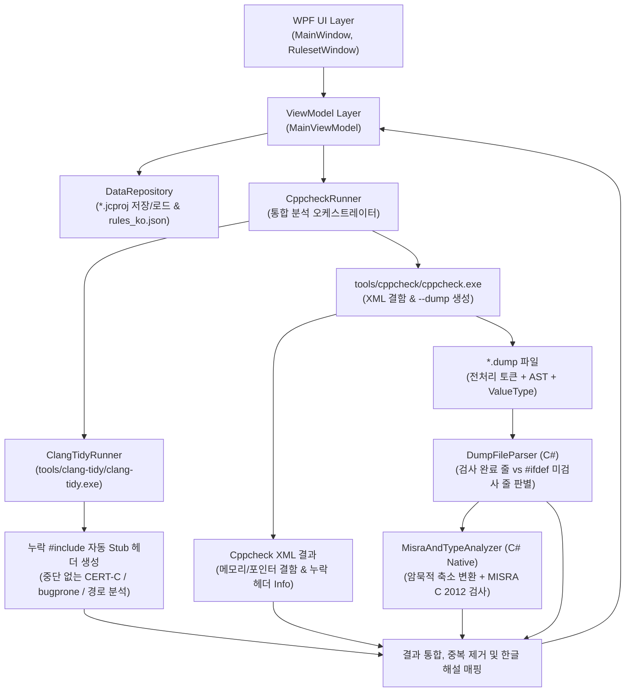

# 02. 시스템 아키텍처 및 분석 엔진 설계서 (Architecture Design)

## 1. 전체 시스템 구조

`전검사(JeonCheck)`는 .NET 10 WPF 기반의 **MVVM 아키텍처**를 따르며, 외부 프로세스인 `cppcheck.exe` 및 `clang-tidy.exe`와 내부 C# 정밀 분석 엔진(`DumpFileParser` + `MisraAndTypeAnalyzer`)이 결합된 하이브리드 정적 분석 파이프라인으로 동작한다.

---

## 2. 정적 분석 파이프라인 상세 흐름

사용자가 **[분석 시작]** 버튼을 클릭하면 `AnalysisOrchestrator`는 다음 4단계로 분석을 수행한다.

### 단계 1: 실행 인자 구성 (`CppcheckRunner`)
1. **타겟 프리셋 적용**:
   - 선택된 타겟의 플랫폼 XML 파일(`--platform=data/targets/ti_c6000_eabi.xml` 등) 지정
   - 타겟 전용 컴파일러 키워드 치환 매크로(`-Dcregister=`, `-Dinterrupt=`, `-Dfar=` 등) 자동 추가
   - C 표준(`--std=c99` 등) 및 `--force` (또는 지정된 매크로 조건) 설정
2. **검사 대상 및 비대상 분리**:
   - 프로젝트에 임포트된 폴더 구조에서 헤더가 위치한 폴더들을 추출하여 `-I <폴더경로>`로 자동 등록 (비대상 폴더의 헤더도 참조 가능하도록 지원)
   - **검사 대상(Target = true)**으로 체크된 `.c` 파일들만 분석 입력 파일로 전달
3. **Cppcheck 실행 옵션**:
   - `--xml --xml-version=2`: 기본 Cppcheck 엔진의 결함 및 `missingInclude` 정보 수집
   - `--dump`: 각 검사 대상 파일에 대해 토큰, AST, 심볼 테이블, 타입 정보(`ValueType`)가 담긴 `.dump` XML 파일 생성 (분석 완료 후 임시 폴더 또는 정리 처리)

### 단계 2: 라인별 검사 완료 / 미검사(Skipped) 줄 판별 (`DumpFileParser`)
코드 뷰어에서 각 줄이 실제로 분석되었는지 판별하기 위해 원본 소스 파일과 `.dump` 파일의 `<rawtokens>` 및 `<tokenlist>`(전처리 후 토큰)를 비교한다.

1. **비코드 라인 분류 (Neutral / Blank & Comment)**:
   - 공백 줄, 주석(`//`, `/* ... */`)만 있는 줄, 전처리 지시문(`#include`, `#define`, `#ifdef`, `#endif` 등) 자체 줄은 배경색을 칠하지 않는 기본 줄로 분류한다.
2. **검사 완료 라인 (Analyzed Line)**:
   - 전처리 후 실제 분석기에 전달된 `<tokenlist>` 내의 `<token>` 들 중 해당 파일(`fileIndex`)에 속하는 토큰들의 `linenr`(줄 번호) 집합을 추출한다.
   - 구문이나 수식이 여러 줄에 걸친 경우 AST 토큰 범위를 포함하여 **검사 완료(Analyzed)** 상태로 표시한다.
3. **미검사 라인 (Skipped Line)**:
   - 원본 파일(또는 `<rawtokens>`)에는 실제 C 코드 토큰이 존재하지만, `#ifdef` / `#if 0` 조건 불충족이나 매크로 미정의 등으로 인해 전처리 후 `<tokenlist>`에서 완전히 사라진 줄 번호를 추출하여 **미검사(Skipped)** 상태로 표시한다.

### 단계 3: C# 네이티브 정밀 타입 및 MISRA C 2012 분석 (`MisraAndTypeAnalyzer`)
Python 및 외부 `misra.py`를 호출하지 않고, `DumpFileParser`가 파싱한 메모리 내 AST/Token/Variable/Scope 모델을 순회하며 C#에서 직접 검사를 수행한다.

#### 3.1 암묵적 축소 변환 (`ImplicitNarrowingConversion`) 검출 알고리즘
1. **대입 및 초기화 검사 (`=` 토큰)**:
   - 이항 연산자 `=` 토큰에서 좌변(`astOperand1`)과 우변(`astOperand2`)의 `ValueType`을 비교한다.
   - 우변 최상위 노드가 명시적 타입 캐스트(`isCast == true`)가 아닌 경우:
     - 타겟 플랫폼 기준 좌변의 비트 크기(`LHS.Bits`) < 우변의 비트 크기(`RHS.Bits`)이면 축소 변환으로 검출한다. (단, 우변이 정수 상수 리터럴이고 좌변 타입의 표현 범위 내에 안전하게 들어가는 경우는 예외 처리 가능)
     - 우변이 실수형(`float`/`double`)이고 좌변이 정수형이거나, 우변이 `double`(64-bit)이고 좌변이 `float`(32-bit)인 경우 검출한다.
2. **함수 인자 전달 검사 (`(` 함수 호출 토큰)**:
   - 호출 대상 함수의 선언(`Function` 심볼)에서 각 매개변수(`Argument` 변수)의 타입/비트 크기와 실제 전달된 인자 표현식의 `ValueType`을 비교하여 암묵적 축소 변환 여부를 검출한다.
3. **함수 반환문 검사 (`return` 토큰)**:
   - 현재 속한 함수(`Scope` → `Function`)의 반환 타입과 `return` 피연산자의 `ValueType`을 비교하여 암묵적 축소 변환 여부를 검출한다.

#### 3.2 C# 변환 MISRA C 2012 규칙 검사기
`misra.py`의 핵심 규칙 검사 로직을 C# 메서드로 모듈화하여 수행한다:
- **형변환 및 타입 (Rule 10.1 ~ 10.8)**: 부적절한 피연산자 타입, 암묵적 축소/부호 변환, 복합 수식 형변환
- **포인터 변환 (Rule 11.1 ~ 11.9)**: 포인터-정수 변환, 서로 다른 객체 포인터 간 변환, `const`/`volatile` 한정자 제거 캐스트
- **연산자 및 수식 (Rule 12.1 ~ 13.6)**: 연산자 우선순위 괄호 명시, 시프트 연산 범위(`Rule 12.2`), 조건문 내 대입 연산자 사용(`Rule 13.4`), `sizeof` 내 부작용(`Rule 13.6`)
- **제어 흐름 (Rule 14.1 ~ 16.7)**: 실수형 루프 카운터 금지, 조건식 boolean 타입, `goto` 사용(`Rule 15.1`), 함수 단일 반환(`Rule 15.5`), `switch` 문 `default`/`break` 구조(`Rule 16.x`)
- **선언 및 함수 (Rule 8.x, 9.x, 17.x)**: 암묵적 타입 선언 금지, 배열 크기 명시, 함수 반환값 무시 금지(`Rule 17.7`), 재귀 호출 금지(`Rule 17.2`)
- **전처리기 및 표준 라이브러리 (Rule 20.x, 21.x)**: `#undef` 사용 제한, 매크로 매개변수 괄호 누락, 동적 메모리 할당(`malloc`/`free`, `Rule 21.3`) 금지 등

### 단계 4: Clang-Tidy 심층 분석 및 누락 헤더 자동 더미(Stub) 처리 (`ClangTidyRunner`)
1. **누락 헤더 자동 더미 생성**:
   - 대상 소스 및 헤더의 `#include "..."` 구문을 스캔하여 현재 프로젝트의 참조 경로(`-I`)에 존재하지 않는 헤더 파일이 있으면 임시 폴더(`%TEMP%/jeoncheck_stubs_*`)에 빈 헤더 파일을 자동 생성한다.
   - 이를 통해 외부 벤더 SDK 헤더 일부가 없더라도 `clang-tidy`가 `fatal error: file not found`로 중단되지 않고 끝까지 분석을 수행한다.
2. **타겟 아키텍처 연동 실행**:
   - 선택된 타겟 프리셋의 `clangTarget`(`armv7r-none-eabi`, `aarch64-none-elf`, `riscv64-unknown-elf`, `powerpc-none-eabihf`, `powerpc64-none-elf`)과 내장 표준 C 헤더(`tools/clang-tidy/include`)를 지정하여 `bugprone-*`, `cert-*`, `clang-analyzer-*` 검사를 수행한다.

### 단계 5: 결과 병합, 룰셋 필터링 및 한글 해설 매핑
1. Cppcheck XML 결과, `MisraAndTypeAnalyzer` 결과, `ClangTidyRunner` 결과를 통합하고, 같은 위치(규칙 + 파일 + 줄 + 열)에 반복 보고된 진단만 제거한다. 가능한 많은 결함을 보여 주기 위해 같은 줄의 서로 다른 결함이나 도구별로 따로 검출된 결과는 모두 표시한다.
2. `missingInclude`, `missingIncludeSystem` 등 환경/참조 관련 알림은 **[노트 / 누락 파일 안내 (Info)]** 탭으로 분리한다.
3. 사용자가 현재 프로젝트의 **Ruleset**에서 활성화(ON)해 둔 규칙 ID에 해당하는 항목만 필터링하고 `data/rules_ko.json`의 한글 상세 해설을 연결한다.
